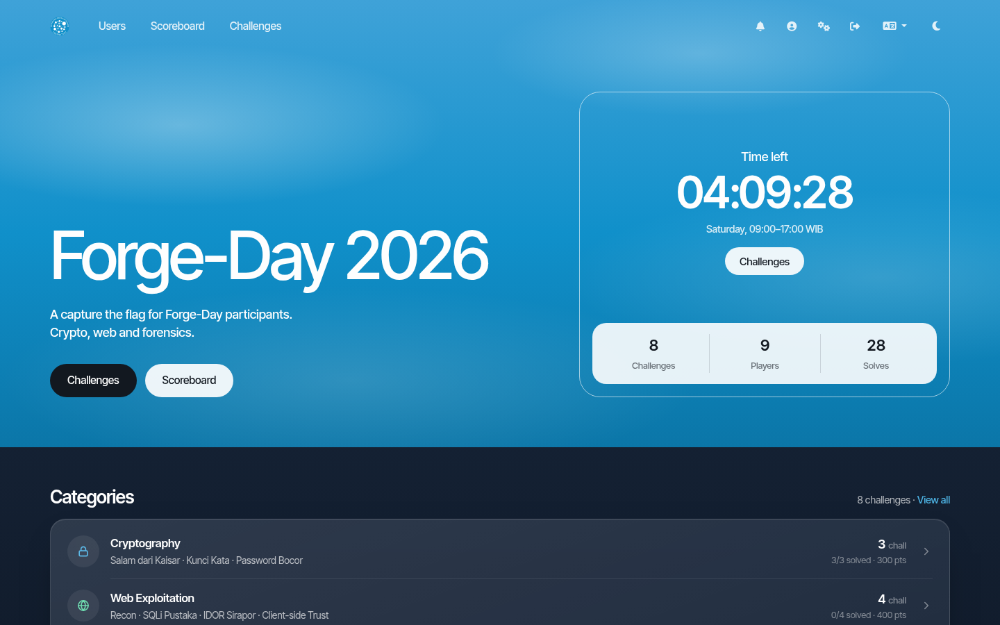
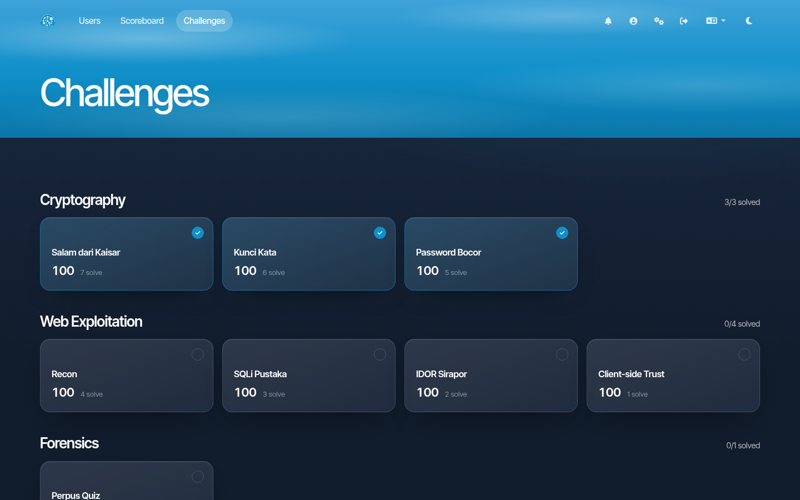
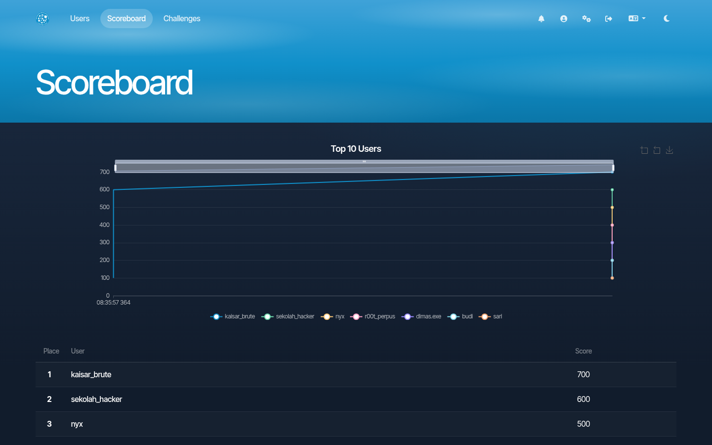
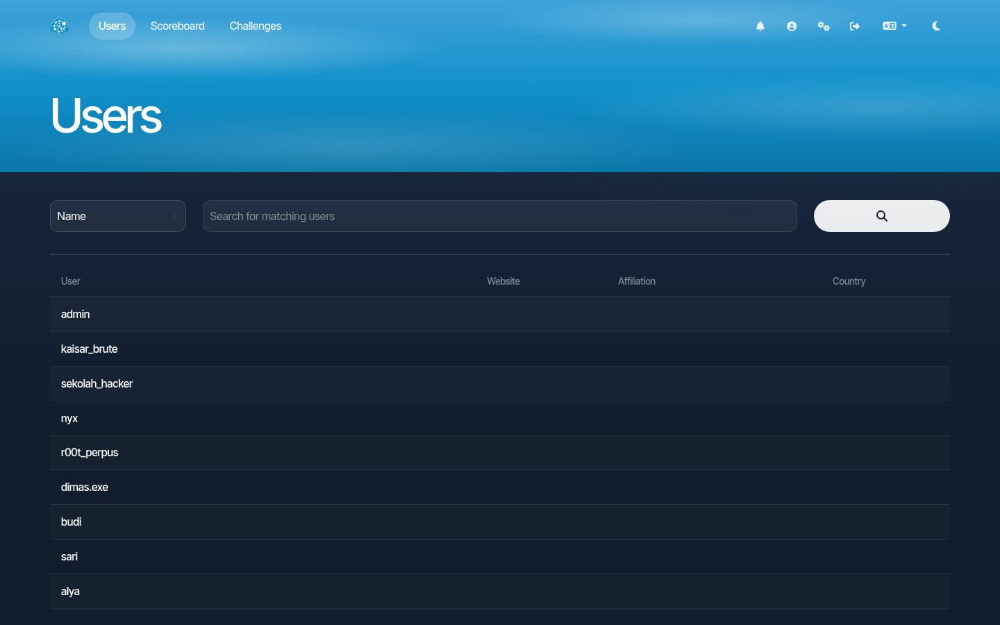

# ICN CTFd Theme

A CTFd theme for ICN-CTF, forked from the CTFd `core` theme (CTFd 3.8.x). Sky blue header, glass panels, dark and light mode.

## Screenshots

| Home | Challenges |
| --- | --- |
|  |  |

| Scoreboard | Users |
| --- | --- |
|  |  |

## Install

1. Copy this folder into your CTFd themes folder as `icn`:

   ```bash
   git clone https://github.com/lab-icn/icn-ctfd-theme CTFd/CTFd/themes/icn
   ```

   With the official `docker-compose.yml` the CTFd folder is mounted into the container, so no image rebuild is needed.

2. Restart CTFd so it picks up the new theme:

   ```bash
   docker compose restart ctfd
   ```

3. In the admin panel go to **Config > Theme**, set **Theme** to `icn` and click **Update**.

4. Optional: click **Build** under **Theme Settings** to set:

   - **Hero Title**: big title on the home page (defaults to the CTF name)
   - **Hero Text**: text under the title (defaults to the CTF description)
   - **Schedule Text**: line under the countdown, for example `Saturday, 09:00-17:00 WIB`
   - **Navbar Icons**: text only, icon and text, or icon only with tooltips

5. Optional: put your rules in **Pages > index**. That page content is shown in the Rules panel on the home page.

The countdown on the home page uses **Config > Start and End Time**.

## Development

Theme specific files:

- `assets/icn/css/icn.css`: all ICN styles
- `assets/icn/js/home.js`: home page data (countdown, categories, top 5)
- `templates/`: Jinja templates, same template variables as `core`

Build after changing anything in `assets/`:

```bash
yarn install
yarn build
```

The build writes to `static/`. After a rebuild, clear the cached asset manifest or CTFd keeps serving old file names:

```bash
docker compose exec -T ctfd python - <<'EOF'
from CTFd import create_app
from CTFd.cache import cache
from CTFd.utils import _get_asset_json
with create_app().app_context():
    cache.delete_memoized(_get_asset_json)
EOF
```

If you only edit `icn.css` or `home.js`, you can skip the build: copy them to `static/css/` and `static/js/`, then bump `icn_version` in `templates/base.html` and the version in `templates/page.html` so browsers fetch the new file.
